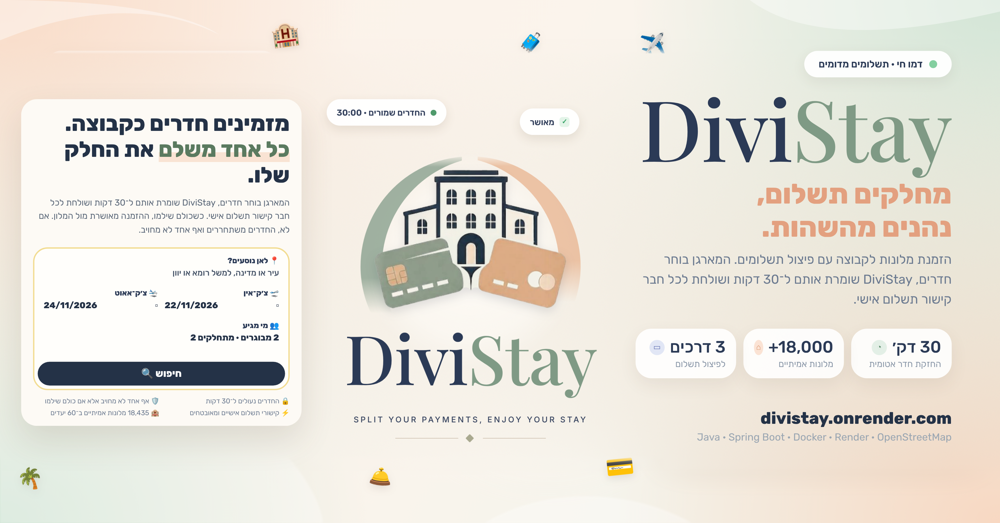

  

  
  
  

  <!---->
  
  
  

<h3 align="center">המארגן בוחר חדרים, וכל אחד משלם מקישור אישי.</h3>

  ההזמנה מאושרת רק כשכל הקבוצה שילמה, ואם היא לא יוצאת לפועל אף אחד לא מחויב.

  

  

פרויקט הדגמה: התשלומים, החדרים, המחירים והביקורות מדומים. הטעינה הראשונה יכולה לקחת כ־30 שניות.

> 📐 התחיל כפרויקט **ארכיטקטורה ודרישות תוכנה** ([DiviStay Architecture](https://github.com/NoyaAdivi/DiviStay_Architecture), SRS ו־UML בתיקייה [`docs/`](docs/)), תוכנן בצוות של 3, ואז **מומש ב־Java 21 וב־Spring Boot** ועלה לאוויר.

<table align="center">
  <tr>
    <td align="center" width="25%"><a href="#s3"><b>🏨 18,000+</b></a> מלונות אמיתיים</td>
    <td align="center" width="25%"><a href="#s1"><b>⏱️ 30 דק'</b></a> החזקת חדרים אטומית</td>
    <td align="center" width="25%"><a href="#s3"><b>🧪 45</b></a> בדיקות JUnit</td>
    <td align="center" width="25%"><a href="https://divistay.onrender.com"><b>🌍 HE · EN</b></a> עברית ואנגלית</td>
  </tr>
</table>

1. **חיפוש ונעילה:** המארגן בוחר חדרים, והם ננעלים ל-**30 דקות** כדי שאף אחד אחר לא יזמין אותם (מניעת הזמנת יתר).
2. **פיצול:** העלות מתחלקת **שווה בשווה**, **לפי חדר** (מי שבסוויטה משלם יותר) או **בסכומים מותאמים אישית**.
3. **תשלום:** כל חבר מקבל קישור תשלום אישי שאי אפשר לנחש. התשלום *מקפיא* את הסכום בכרטיס.
4. **אישור:** כשמגיעים ל-100%, ההזמנה נשלחת למלון. אם המלון אישר, הסכומים *נגבים* ונשלחות קבלות. אם מערכת המלון לא עונה, המערכת **מנסה שוב** עם המתנה שהולכת וגדלה.
5. **ביטול אוטומטי:** אם הזמן נגמר, או שהמלון לא אישר, החדרים משתחררים וכל הקפאה **מבוטלת**, כך שאף אחד לא מחויב.

| תבנית | איפה | למה |
|---|---|---|
| **Strategy** | `SplitStrategy`, ושלוש המימושים שלו | לוגיקת ההזמנה לא יודעת איך העלות מתחלקת. כלל פיצול חדש הוא מחלקה אחת חדשה. |
| **Factory** | `SplitStrategyFactory`, `RoomFactory` | מקום אחד מחליט באיזו אסטרטגיה להשתמש ואיך נבנה כל סוג חדר. |
| **Adapter** | `PaymentGateway`, `MockPayGatewayAdapter`, `MockPayClient` | הליבה מדברת עם ממשק תשלום משלה. החלפת ספק תשלום היא Adapter חדש. |
| **Ports & adapters** | `HotelPmsClient`, `NotificationService`, ה-repositories | בליבה **אין תלות ב-Spring**. Spring רק מחבר את החלקים (`AppConfig`). |

- **מלונות אמיתיים:** יותר מ-18,000 מלונות אמיתיים ב-60 יעדים ו-21 מדינות, מתוך OpenStreetMap (רישיון ODbL): שם, כתובת, מיקום וכוכבים כשידועים. החדרים, המחירים וחוות הדעת מדומים (אין גישה לזמינות אמיתית), והתמונות מתאימות לסוג המקום: עיר, חוף, אי יווני או ריזורט.
- **חיפוש לפי עיר או מדינה,** בעברית או באנגלית, ועמוד יעדים לפי מדינות.
- **חיפוש כמו באתר אמיתי:** מבוגרים, ילדים עם גילאים, וכמה מתחלקים בתשלום. לכל מלון מחושב צירוף החדרים הזול ביותר שמספיק לכל הקבוצה (בעיית תרמיל קטנה), עם המחיר לכל משלם. סינון לפי כוכבים, דירוג, מחיר ומתקנים, מיון ועמודים.
- **מקביליות:** נעילת חדרים היא פעולה אטומית של "הכול או כלום". בדיקה מריצה 32 תהליכונים שמתחרים על אותו חדר ומוודאת שרק אחד מצליח.
- **כסף:** נשמר באגורות שלמות (`long`), אף פעם לא כמספר עשרוני, ולכן הפיצול תמיד מסתכם בדיוק.
- **אבטחה:** קישורי התשלום ולוח הבקרה הם מחרוזות אקראיות של 256 ביט, ונשמר רק ה-hash שלהן. פרטי כרטיס לא נשמרים לעולם.
- **Idempotency:** אותו חבר שמשלם עם אותו כרטיס פעמיים (לחיצה כפולה) לא יחויב פעמיים.
- **מכונת מצבים:** `BookingGroup` מאפשר רק מעברים חוקיים בין המצבים.
- **שתי שפות:** אנגלית ועברית (מימין לשמאל) עם `MessageSource` של Spring. שפת הדפדפן מזוהה אוטומטית והבחירה נשמרת. הודעות שמגיעות מהליבה מתורגמות בשכבת ה-web (`Translator`), כך שהלוגיקה העסקית לא תלויה בשפה.
- **נגישות:** תפריט נגישות (גודל טקסט, ניגודיות גבוהה, הדגשת קישורים, גופן קריא, עצירת אנימציות וסמן גדול), ניווט מלא במקלדת, ניגודיות צבעים ברמת AA והצהרת נגישות.
- **מצב כהה:** לפי הגדרת המערכת, עם אפשרות להחליף ידנית.
- **עמודים משפטיים:** מדיניות פרטיות, תנאי שימוש והצהרת נגישות, בשתי השפות.
- **בדיקות:** JUnit 5 לכללי הפיצול, לנעילה ולמקביליות, לכל מחזור החיים, ל-Adapter של התשלום, ובדיקת קצה-לקצה של האתר עם MockMvc.

**בווינדוס, בלי שום הגדרה:** לחיצה כפולה על `START-DIVISTAY.bat`. הקובץ מוצא Java 21 ומעלה במחשב, מוריד את Maven בפעם הראשונה, מפעיל את האתר ופותח את הדפדפן. `TEST-DIVISTAY.bat` מריץ את כל הבדיקות.

צריך **Java 21 ומעלה**. אפשר גם עם **IntelliJ IDEA**:

1. `File → Open`, ובוחרים את התיקייה הזו (זו שיש בה `pom.xml`). מחכים ש-Maven יוריד את הספריות.
2. פותחים את `src/main/java/com/divistay/DiviStayApplication.java` ולוחצים ▶ **Run**.
3. נכנסים ל-**http://localhost:8080**.

**לנסות:** יוצרים קבוצה עם 2-3 כתובות מייל, פותחים את קישורי התשלום מתיבת *Messages sent* בלוח הבקרה, ומשלמים עם כרטיס הבדיקה `4242 4242 4242 4242` (כל תאריך עתידי וכל CVC).

האתר הוא שרת Java, ולכן הוא לא עולה ל-Vercel. הדרך הפשוטה היא [Render](https://render.com), שיש לו מסלול חינמי:

1. מעלים את הפרויקט ל-GitHub (מאגר חדש, למשל `DiviStay`).
2. נכנסים ל-Render עם חשבון GitHub, ובוחרים **New → Blueprint** ואת המאגר. הקובץ `render.yaml` כבר מגדיר הכל, ו-Render בונה את האתר לפי ה-`Dockerfile`.
3. אחרי כמה דקות מקבלים כתובת כמו `https://divistay.onrender.com`.

כדאי לדעת: במסלול החינמי השרת נרדם אחרי 15 דקות בלי ביקורים, והטעינה הראשונה אחרי זה לוקחת כחצי דקה. כל ההזמנות נשמרות בזיכרון, אז הן מתאפסות כשהשרת מתחיל מחדש. זה בסדר לאתר הדגמה.

התשלומים ומערכת המלון **מדומים** (אין כסף אמיתי), ההודעות מוצגות על המסך במקום במייל, והמידע נשמר בזיכרון. כל אחד מהם נמצא מאחורי ממשק, ולכן הצעדים הבאים הם Adapters חדשים, לא כתיבה מחדש: ספק תשלום אמיתי, API של מלון, שירות מייל ומסד נתונים.

<i>תוכנן על ידי נויה, עמית ואמיר במסגרת קורס הנדסת תוכנה; מומש על ידי נויה.</i>

  
  
  
  

